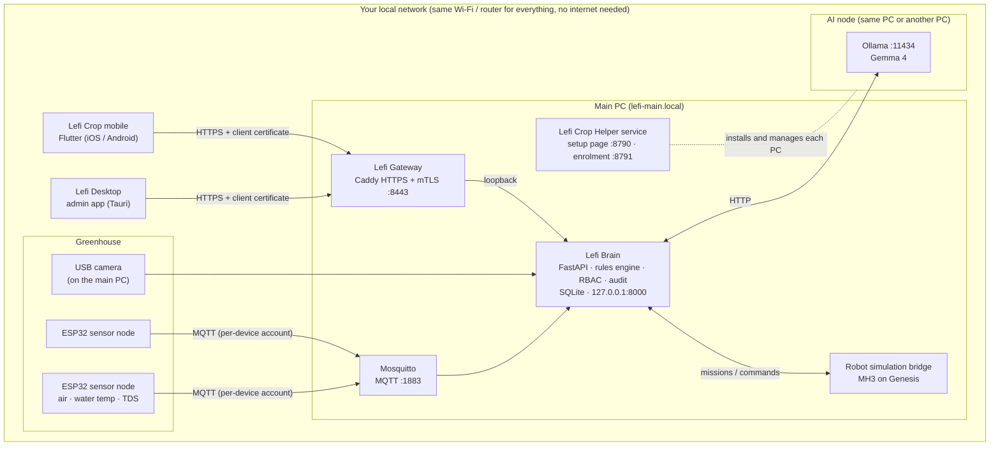

# Lefi Crop AI

**Local-first greenhouse intelligence: sensors, local AI, vision and simulated robotics — fully offline on your own network.**

> A plant reports its state, Lefi Brain understands the problem, Lefi explains what is happening and the
> system coordinates a response that people can verify.

Built for the [Build with AI: Smart Automation, Robotics and Vision](https://www.kaggle.com/competitions/build-with-ai-smart-automation-robotics-and-vision/overview) competition.

**Core principle: the AI reasons; the control layer validates and authorises.** Lefi AI (a local Gemma 4 model
on Ollama) reads, explains and proposes. It never drives an actuator. Every action goes through an allowlist,
role permissions, limits and an audit trail.

---

## Downloads

| Installer | Platform | Where | Guide |
|---|---|---|---|
| **Lefi Crop Helper 0.5.25** (`LefiCropHelper-0.5.25-hackathon.dmg`) — installs every PC; carries Lefi Brain, Lefi Desktop 0.13.0 and the installer | macOS on Apple Silicon | [`release/macos/`](release/macos) | [§5](#5-run-lefi-crop-helper) |
| **Lefi Crop mobile 0.4.0** (`lefi-crop-0.4.0-arm64-v8a.apk`, `…-armeabi-v7a.apk`, `…-universal.apk`) | Android 7+ | [`release/android/`](release/android) (universal APK on the **Releases** page) | [§10.1](#101-android-apk-2-minutes) |
| **Lefi Crop mobile 0.4.0** (TestFlight) | iOS 15+ | TestFlight invitation link provided with the submission | [§10.2](#102-iphone-ios) |

Checksums (SHA-256): [`release/SHA256SUMS.txt`](release/SHA256SUMS.txt). The ESP32 firmware is built from
`firmware/esp32-node` with your own network settings ([§9](#9-connect-the-esp32-sensor-nodes)).

---

## Contents

1. [Architecture](#1-architecture)
2. [Before you start: the local network](#2-before-you-start-the-local-network)
3. [Choose a configuration: single PC or multi PC](#3-choose-a-configuration-single-pc-or-multi-pc)
4. [Requirements](#4-requirements)
5. [Run Lefi Crop Helper](#5-run-lefi-crop-helper)
6. [Single-PC installation](#6-single-pc-installation)
7. [Multi-PC installation (setup URL)](#7-multi-pc-installation-setup-url)
8. [Sign in to Lefi Desktop](#8-sign-in-to-lefi-desktop)
9. [Connect the ESP32 sensor nodes](#9-connect-the-esp32-sensor-nodes)
10. [Install the mobile app](#10-install-the-mobile-app)
11. [How to use the apps](#11-how-to-use-the-apps)
12. [Simulated robot (MH3)](#12-simulated-robot-mh3)
13. [No hardware? Use the simulators](#13-no-hardware-use-the-simulators)
14. [Daily operation and emergency stop](#14-daily-operation-and-emergency-stop)
15. [Running the tests](#15-running-the-tests)
16. [Troubleshooting](#16-troubleshooting)
17. [Repository layout](#17-repository-layout)
18. [License](#18-license)

---

## 1. Architecture

Everything runs on one local network. There is no cloud service: after installation the system works with the
internet unplugged.



| Component | What it does | Where it runs |
|---|---|---|
| **Lefi Brain** (`services/brain`) | Python modular monolith: telemetry ingestion, rules engine and alerts, tasks, shifts and handover, crop knowledge, cameras and vision, robot missions, users/roles, hash-chained audit trail, Lefi AI assistant (read-only tools) | Main PC, bound to `127.0.0.1` |
| **Mosquitto** | MQTT broker; each ESP32 has its own account and ACL | Main PC |
| **Lefi Gateway** (Caddy) | The only door into Lefi Brain from the LAN: HTTPS with its own CA and mutual TLS (each paired PC/phone holds a device certificate) | Main PC |
| **AI node** (Ollama + Gemma 4) | Local LLM used by Lefi Brain only. Model list: `config/supported-models.tsv` | Main PC or another PC |
| **Lefi Crop Helper** (`apps/helper`) | Activation, guided installation of each PC, console (status, nodes, apps, backups, updates). The bash installer (`scripts/install.sh`) is the only engine it drives | Main PC (window) + every other PC (service) |
| **Lefi Desktop** (`apps/desktop`) | Admin client: dashboard, greenhouses and crops, environment, alerts, tasks, shifts, AI control and kill switch, cameras, robot mission center | Any PC |
| **Lefi Crop mobile** (`apps/lefi-mobile`) | Field app: tasks with photo evidence, zones and plants, alerts, shift handover, AI control, cameras, robot, chat with Lefi AI, NFC plant tags | Phones on the same network |
| **ESP32 firmware** (`firmware/esp32-node`) | One firmware for every board; sends 1 Hz telemetry, heartbeats and events over MQTT | Sensor boards |
| **Simulators** (`simulators/`) | Greenhouse telemetry simulator (same MQTT contract, labelled `SIMULATED`) and the MH3 robot bridge | Main PC |

**Safety by design**

- Observation → interpretation (AI) → recommendation → decision → authorisation → execution → audit are kept
  separate. LLM output is parsed against a schema; invalid output is stored as invalid and never executed.
- No pump, valve, relay or motor is controllable. Irrigation is interface-only and disabled.
- **STOP AI** in Lefi Desktop / mobile (or `lefi ai off`) halts every AI use immediately.
- Simulated data is always labelled `SIMULATED`; the robot is a simulation and is shown as such.

---

## 2. Before you start: the local network

> **Every part of Lefi Crop must be connected to the same local network.** The main PC, the AI node, every
> other PC, the ESP32 boards and the phones must all be on the same router / Wi-Fi. If one of them is on another
> network (guest Wi-Fi, mobile data, VPN), it cannot reach Lefi Brain.

Configure your router before installing:

| Item | Why |
|---|---|
| One router for everything (Wi-Fi + Ethernet on the same LAN) | All parts talk directly to each other |
| A **2.4 GHz** Wi-Fi network | The ESP32 has no 5 GHz radio (PCs and phones may use 5 GHz on the same router) |
| **Client / AP isolation off**, guest network not used | Isolation blocks PC ↔ PC and board ↔ PC traffic |
| **mDNS / Bonjour allowed** | PCs and boards find the main PC as `lefi-main.local` (otherwise use its IP address) |
| **DHCP reservation** (fixed IP) for the main PC and the AI node | Addresses stay the same after a restart |
| On macOS: allow incoming connections for `ollama`, `mosquitto`, `caddy` and Lefi Crop Helper when asked; turn off "Private Wi-Fi address" for this network | Otherwise the firewall or a rotating MAC breaks connections |
| Keep the PCs awake (`sudo pmset -c sleep 0`) during a demo | A sleeping PC drops off the network |

Ports used on the LAN: `1883` MQTT · `8443` Lefi Gateway · `8790` setup page · `8791` PC enrolment ·
`11434` Ollama (AI node, only when it serves another PC).

Internet is needed **only during installation** (Homebrew packages, the Gemma model, the robot starter). After
that you can unplug the router's WAN.

---

## 3. Choose a configuration: single PC or multi PC

| | **Single PC** | **Multi PC** (recommended) |
|---|---|---|
| Machines | One Mac runs everything | One main PC + one or more other PCs (nodes) |
| Main PC runs | Lefi Brain, broker, Lefi Gateway, AI node, Lefi Desktop | Lefi Brain, broker, Lefi Gateway, simulated robot, Lefi Desktop |
| Other PCs run | — | AI node (Ollama + Gemma 4), optionally Lefi Desktop |
| Simulated robot | **Not available** (the robot never runs on the AI node's PC) | Available on the main PC |
| How other PCs join | — | They open the **setup URL** `http://<main-pc-ip>:8790/setup` |

Reference setup used to build the project: main PC = MacBook Pro, AI node = MacBook Pro 16" M1 Pro,
`gemma4:12b` fully on the GPU (~7.4 GB at context 4096).

---

## 4. Requirements

- **macOS on Apple Silicon** for every PC (Lefi Crop Helper is macOS-only today; the bash installer also
  supports Linux with systemd). The AI node needs enough memory to run the model: Lefi Crop Helper measures it
  and tells you (`lefi hw`).
- An administrator account on each Mac and internet access **during installation**. The installer installs what
  it needs itself: Homebrew, Ollama and the Gemma model, Mosquitto, Caddy and uv.
- **Other PCs** (multi PC) need nothing installed beforehand: only Terminal, on the same network.
- For the mobile app: an Android phone (APK) or an iPhone with TestFlight.
- For the ESP32 boards: [PlatformIO](https://platformio.org) or the Arduino IDE (Arduino-ESP32 2.x).
- **Only to build from source** (§5.2): Xcode Command Line Tools (`xcode-select --install`),
  [Rust](https://rustup.rs) (stable), Node.js 22+ with pnpm 10 (`corepack enable`), [uv](https://docs.astral.sh/uv/),
  and [Flutter](https://docs.flutter.dev/get-started/install) 3.47+ for the mobile app.

---

## 5. Run Lefi Crop Helper

Lefi Crop Helper is the app that installs and manages every PC. It runs on the **main PC**.

### 5.1 From the installer (recommended)

1. On the main PC, take [`release/macos/LefiCropHelper-0.5.25-hackathon.dmg`](release/macos) from this repository
   (clone it, or open the file on GitHub and press **Download raw file**).
2. Open it and drag **Lefi Crop Helper** into **Applications**.
3. The app is signed ad hoc, not notarised by Apple, so the first time macOS refuses to open it. Open it once like
   this: **right-click Lefi Crop Helper → Open → Open**. If macOS still blocks it: *System Settings → Privacy &
   Security → "Lefi Crop Helper" was blocked → Open Anyway*. From Terminal the same is
   `xattr -dr com.apple.quarantine "/Applications/Lefi Crop Helper.app"`.
4. In the **Activation** step press **Activate for the hackathon**. This build needs no activation code: it
   activates this installation for up to 10 PCs.
5. Continue with §6 (single PC) or §7 (multi PC).

### 5.2 From source

```bash
git clone <this repository> lefi-crop-ai && cd lefi-crop-ai
pnpm install

# Build the parts Lefi Crop Helper installs or shares
cargo build --manifest-path apps/helper/helperd/Cargo.toml          # the Lefi Crop Helper service
pnpm --filter @lefi/desktop tauri build --bundles app               # Lefi Desktop (installed by the "desktop" role)

# Start Lefi Crop Helper
pnpm dev:helper
```

A development build accepts development activation codes. The **Activation** step shows this installation's id
(`XXXX-XXXX-XXXX-XXXX`); create a code for it with the bundled tool and paste the printed `LEFI1-…` code:

```bash
cargo run --features issue --manifest-path tools/lefi-license/Cargo.toml -- \
  issue --dev --installation <INSTALLATION-ID> --customer "Judges" --max-pcs 3 --support-until 2027-12-31
```

To build the installer yourself: `pnpm --filter @lefi/helper bundle:hackathon` (runs the release checks first,
then writes `apps/helper/src-tauri/target/release/bundle/LefiCropHelper-<version>-hackathon.dmg`).
`pnpm --filter @lefi/helper bundle` builds the normal package, which accepts only activation codes signed by
Lefi Crop.

---

## 6. Single-PC installation

Everything on one Mac (no simulated robot, see §3).

1. Connect the Mac to the local network (§2).
2. In Lefi Crop Helper follow the steps: **Welcome → Activation → Scan → Roles & model → Plan → Install → Verify → Finish**.
3. In **Roles & model** choose: **Core** (Lefi Brain + broker + database), **Admin** (Lefi Gateway),
   **AI node** with model `gemma4:12b` (or `gemma4:e4b` if memory is tight), and **Lefi Desktop**.
4. **Plan** shows exactly what will be done (a dry run, nothing changes). **Install** streams every step; you
   can cancel and undo at any point.
5. At the end Lefi Crop Helper shows the **administrator credentials once**. Save them (they are also stored in
   `~/.lefi-crop/credentials/admin.txt`, readable only by you).
6. **Finish setup and continue** opens the console (Status, Nodes, Apps, Backups, Settings).

Check from Terminal:

```bash
lefi status      # every service on this PC
lefi check       # full verification: no FAIL expected
lefi ai test     # a real answer from the local model, with tokens/s
```

---

## 7. Multi-PC installation (setup URL)

Lefi Brain needs a working AI node when it is installed, so the AI PC joins and gets its AI first, then the main
PC installs Lefi Brain pointing at it.

### 7.1 Main PC: activate and open the setup URL

1. On the main PC follow §5 up to **Activation**.
2. Open **Nodes** (available during the setup steps) and press **Start the Lefi Crop Helper service**. Choose
   *starts with this Mac* (asks for the administrator password once) or *only while I am logged in*.
3. Lefi Crop Helper now shows the **setup URL** of this installation:

   ```
   http://<main-pc-ip>:8790/setup
   ```

4. Press **Add a node → Create a code**. You get a one-time **join code** and the command to join (valid once,
   for a limited time; optionally only for one IP address).

### 7.2 Each other PC joins (AI node, extra Lefi Desktop…)

1. Connect it to the **same network** as the main PC.
2. Open the **setup URL** `http://<main-pc-ip>:8790/setup` in a browser on that PC.
3. Type the join code on the page, or run the command it shows in Terminal:

   ```bash
   curl -fsS http://<main-pc-ip>:8790/setup/join.sh | sh -s -- <JOIN-CODE>
   ```

   The PC downloads the Lefi Crop Helper service from the main PC, gets a certificate signed by the main PC and
   starts sending its status (if Terminal asks for this PC's password, type it). Check that the **security
   fingerprint** on the page is the one Lefi Crop Helper shows on the main PC.
4. The page now lists what is still missing, one step at a time.

### 7.3 Install the AI node on that PC (from the main PC)

1. In **Nodes**, the new PC appears as `lefi-node-1` (then `lefi-node-2`, …).
2. Choose its components: **AI node** with `gemma4:12b` (or `gemma4:e4b` if memory is tight); optionally
   **Lefi Desktop**.
3. Press **Preview** (dry run, nothing changes) and then **Install**. Progress streams live in Lefi Crop Helper
   and on that PC's setup page. You can cancel (rolls back on that PC) or undo the last installation.
4. When it is installed, the **AI speed test** in Nodes measures real tokens per second on that PC.

### 7.4 Install the main PC

1. Back in the setup steps: **Scan → Roles & model**. Choose **Core**, **Admin** and **Lefi Desktop** (not AI).
2. The card **The AI runs on another PC** lists the AI nodes found on the joined PCs: select yours (it is tested
   automatically).
3. **Plan → Install → Verify → Finish**, as in §6 (save the administrator credentials).
4. Check:

   ```bash
   lefi status        # on the main PC: remote AI node reachable
   lefi ai status     # on the AI node: Ollama answering, model on the GPU
   ```

Every PC keeps its own page at the setup URL (status, logs, available updates). There is no remote shell:
the main PC can only ask a PC to install, remove, start/stop/measure the AI, pair Lefi Desktop, update its
service or erase Lefi Crop.

---

## 8. Sign in to Lefi Desktop

Lefi Desktop talks to Lefi Brain only through Lefi Gateway (`https://lefi-main.local:8443`) with a device
certificate, so every PC is **paired once**.

- **On a PC installed by Lefi Crop Helper** the desktop app is paired automatically. Open **Lefi Crop** from
  Applications.
- **Any other PC or a development copy**: on the main PC open Lefi Crop Helper → **Apps** → *Create a pairing
  code* (or run `lefi pair new --label my-pc`). In Lefi Desktop choose *Pair this PC with a code*, enter
  `https://lefi-main.local:8443` (or `https://<main-pc-ip>:8443`) and the code.

Sign in with the administrator credentials from §6. You are asked to change the password on first sign-in.
Then, in **Workforce**, create people with their roles (manager, grower, supervisor, scout, maintenance,
worker).

Suggested first tour: **Greenhouses & Crops** (create a greenhouse, zones and plants) → **Devices & Health**
(add the ESP32 boards, §9) → **Executive Dashboard** → **Alerts & Incidents** → **Tasks** → **Chat with Lefi** →
**AI Control & Safety** (STOP AI).

---

## 9. Connect the ESP32 sensor nodes

One firmware for every board (`firmware/esp32-node/lefi_node`). Supported sensors: SHT31 (air temperature and
humidity, I²C), DS18B20 (water temperature, 1-Wire), KEYESTUDIO TDS meter (analog). Layouts: `dual`,
`single-tds`, `single`, `dual-tds`, `custom`.

1. **Register the board in Lefi Desktop**: Devices & Health → **Add device** → *Manually* (network Wi-Fi and
   the MAC address the board prints at boot). Lefi Brain gives the **device id** (also its MQTT username);
   press **Create connection password** (shown only once).
2. **Create the board's file** (it holds passwords, so it is git-ignored):

   ```bash
   cd firmware/esp32-node/lefi_node
   cp board.example.h board_esp32-01.h
   ```

3. **Fill in your network and the board's identity** in `board_esp32-01.h`:

   ```c
   #define LEFI_WIFI_SSID     "YOUR_WIFI_SSID"        // your 2.4 GHz network (same LAN as the main PC)
   #define LEFI_WIFI_PASSWORD "YOUR_WIFI_PASSWORD"
   #define LEFI_MQTT_HOST     "lefi-main.local"       // or the main PC's LAN IP, e.g. "192.168.x.y"
   #define LEFI_MQTT_PORT     1883
   #define LEFI_DEVICE_ID     ""                      // from step 1
   #define LEFI_MQTT_PASSWORD ""                      // from step 1
   ```

   Set the pins of the sensors you wired (`-1` = not wired). The build stops on a pin the ESP32 cannot use.
4. Point `LEFI_BOARD_FILE` in `lefi_config.h` at your file (default `board_esp32-01.h`) and upload:

   ```bash
   cd firmware/esp32-node
   pio run -e board -t upload && pio device monitor     # or open lefi_node/lefi_node.ino in the Arduino IDE
   ```

5. The serial monitor shows the readings and `connected to lefi-main.local`. In Lefi Desktop the board turns
   online; **enable its sensors** and assign each one to the zone it measures. Readings arrive every second.

Check the broker from the main PC: `lefi mqtt clients` and `lefi mqtt watch`.

---

## 10. Install the mobile app

Lefi Crop mobile 0.4.0 runs on Android 7+ and iOS 15+. The phone must be on the **same network** as the main PC.

### 10.1 Android (APK, 2 minutes)

Ready-made packages are in [`release/android/`](release/android) and on the repository's **Releases** page
(signed for direct installation; the app is not on Google Play):

| File | For |
|---|---|
| `lefi-crop-0.4.0-arm64-v8a.apk` | Almost every phone from 2017 on (**use this one**) |
| `lefi-crop-0.4.0-armeabi-v7a.apk` | Older 32-bit phones |
| `lefi-crop-0.4.0-universal.apk` | Any phone (bigger; on the Releases page) |

Checksums: [`release/SHA256SUMS.txt`](release/SHA256SUMS.txt).

1. Copy the APK to the phone (USB cable, e-mail, a shared folder, or download it from the Releases page on the phone).
2. Open it. Android asks to **allow installing unknown apps** for the app you opened it with (Files, Chrome…):
   *Settings → Allow from this source*, then go back.
3. Tap **Install** (Play Protect may say the app is unknown: *More details → Install anyway*). The app is not on
   Google Play, so this warning is expected.
4. Open **Lefi Crop**.

From a PC with [adb](https://developer.android.com/tools/adb) and USB debugging on:
`adb install release/android/lefi-crop-0.4.0-arm64-v8a.apk`.

### 10.2 iPhone (iOS)

Apple allows installing an app on someone else's iPhone only through Apple's channels. Pick one:

**A. TestFlight (recommended for judges)**: no Mac or cable needed.

1. Install **TestFlight** from the App Store on the iPhone.
2. Open the Lefi Crop TestFlight invitation link (provided with the submission) and tap **Accept → Install**.
3. Open **Lefi Crop**. When iOS asks to find devices on your **local network**, tap **Allow** (the app needs it to
   reach Lefi Brain). Allow the camera when you attach a task photo.

**B. Build it yourself with Xcode** (any Apple ID, even a free one):

1. On a Mac with Xcode and Flutter: `cd apps/lefi-mobile && flutter pub get`.
2. `open ios/Runner.xcworkspace` → target **Runner** → **Signing & Capabilities** → choose your **Team** and, if
   needed, change the **Bundle Identifier** to something unique (e.g. `com.yourname.leficrop`).
3. Connect the iPhone by cable, unlock it and trust the Mac. On the iPhone enable
   *Settings → Privacy & Security → Developer Mode* (iOS asks to restart).
4. `flutter run --release` (or ▶ in Xcode with the iPhone selected).
5. With a free Apple ID, trust the developer once: *Settings → General → VPN & Device Management → your Apple ID →
   Trust*. Apps signed with a free account stop opening after 7 days: run step 4 again.

### 10.3 Connect the app to Lefi Brain

1. On the main PC: Lefi Crop Helper → **Apps** → *Lefi Desktop connections* → **Create a pairing code** (or
   `lefi pair new --label phone`). The code is valid for 10 minutes and only once.
2. In the app: **Connect to Lefi Brain** → address `lefi-main.local` (or the main PC's IP) → the code → a name
   for the phone → **Pair**.
3. Sign in with a Lefi account (created in Lefi Desktop → Workforce). The session stays until you sign out.

Until it is paired, the app shows labelled **DEMO DATA** so it can be explored without a server.

### 10.4 Building the packages again

```bash
cd apps/lefi-mobile
flutter build apk --release --split-per-abi   # → build/app/outputs/flutter-apk/
flutter build apk --release                   # universal APK
flutter build ipa --release                   # → build/ios/ipa/ (upload to TestFlight with Transporter)
```

---

## 11. How to use the apps

Every screen shows where its data comes from: **LIVE**, **SIMULATED**, **STALE** (old reading), **OFFLINE** or
**ERROR**, and anything written by Lefi AI is labelled **AI** with the model that wrote it. What a person can see
and do depends on their role: administrator, manager, grower, supervisor, scout, maintenance, worker.

### 11.1 Lefi Crop Helper (main PC): install and look after the PCs

| Section | Use it to |
|---|---|
| **Status** | See every PC and component, measured now (CPU, memory, GPU, AI model loaded) |
| **Nodes** | Start the service, show the setup URL, create join codes, choose and install each PC's components, preview, cancel, undo, AI start/stop/speed test |
| **Apps** | Install or update Lefi Desktop on each PC, create pairing codes for PCs and phones, see paired devices and revoke one |
| **Backups** | Back up the main PC to an external disk (now or every 6/12/24 h) and restore parts or everything |
| **Settings** | Administrator password, offline signed updates, uninstall this PC, erase Lefi Crop from every PC |

Anything that removes something asks for the administrator's password.

### 11.2 Lefi Desktop (admin client)

A typical first session, as administrator:

1. **Workforce** → add people and give them roles; **Shifts** → shift types, the weekly roster and the on-call
   roster (in the greenhouse's time zone).
2. **Greenhouses & Crops** → create a greenhouse, its **zones**, growing locations (benches, rows, levels) and
   plants; group plants into **crop batches**. Drill down greenhouse → zone → batch → plant.
3. **AI Knowledge Center** → crop profiles (draft → review → published) with the ranges of each parameter. Lefi
   Brain judges each zone's readings against the published ranges of the species growing there.
4. **Devices & Health** → add the ESP32 boards (§9), enable their sensors and choose the zone each sensor
   measures; add USB cameras and the simulated robot.
5. Watch it work:

| Screen | What you get |
|---|---|
| **Executive Dashboard** | Status ring (sensors receiving), zones by alerts, sensor cards with ranges and 2 h lines, 24 h and 30-day trends, zone health reviews |
| **Environmental Monitoring** | Per zone: values with provenance, the species' ranges, 24 h / 7 d / 30 d history with statistics |
| **Alerts & Incidents** | Alerts from the rules engine (broker, device contact, sensor errors, values out of range, sudden changes) with root cause first; acknowledge, resolve; rules made by people; Lefi AI's analysis of each alert (diagnosis, causes, suggested actions — a hint, never an action) |
| **Tasks & Work Orders** | Tasks made from alerts or by people (`T-0001`), assigned to the least busy person of the right role, due time, photo evidence, verify or return |
| **Shift Handover** | The facts of the shift from stored data, Lefi AI's summary as a draft, sign → the incoming person acknowledges |
| **Escalation Rules** | Who is told, level by level, when an alert is not acknowledged |
| **AI Plant Health** | People's observations and inspection requests per plant |
| **Visual monitoring** (in each zone) | Its cameras, scheduled zone photos, Lefi AI's findings ("to confirm"), live video, printable zone markers for calibration |
| **Robot Mission Center** | The simulated MH3: 3D views, 2D map, missions, cancel and safe stop |
| **Chat with Lefi** | Ask about your greenhouse; Lefi answers from real data through read-only tools, and each answer says what it read |
| **AI Control & Safety** | What uses the AI, the allowlist of actions and the **STOP AI** emergency stop with a reason (resume later) |
| **Administration** | Role matrix, the audit trail (every change, who and when), paired PCs |

The bell shows your notifications (also as operating-system notifications while the app is open).

### 11.3 Lefi Crop mobile (field)

| Tab | Use it to |
|---|---|
| **Home** | Your overview for your role, your tasks and work to verify, **Ask Lefi** (chat), the robot card |
| **Tasks** | Mine / team; start, mark done with notes and a photo (camera or library), verify or return, assign, priority, due time, new task |
| **Greenhouse** | Greenhouse → zone (live readings with provenance and ranges, batches, tasks, cameras, environment history) → plant (summary, Lefi AI's short summary, observations, report an issue, request an inspection) |
| **Alerts** | The alerts you may see; acknowledge and resolve when your role allows; notifications |
| **Profile** | Your shifts and on-call days, shift handover (sign / acknowledge), notification level, AI control & safety (emergency stop), devices & health |

Plant NFC tags: write `leficrop://lefi/plant/<plant id>` on an NFC tag (the plant screen has a **Copy** button).
Android opens the plant when the tag is tapped; on iPhone, add a Shortcuts automation *NFC → Open URL*.
A plant can always be picked by hand too.

---

## 12. Simulated robot (MH3)

The robot is a **simulation** of the MH3 robot on [Genesis](https://genesis-embodied-ai.github.io/), always
labelled `SIMULATED`. It runs on the main PC and never on the AI node's PC, so it needs the multi-PC setup.

1. Lefi Desktop → **Devices & Health → Robots & drones → Add simulated robot**. Lefi Crop Helper installs the robot role on the main PC
   (it fetches the MH3 starter on that PC; the `MH3.usd` model is never redistributed by this repository).
2. Turn it on from the same screen (the power state, reason and log are shown).
3. **Robot Mission Center**: 3D views (`overview`, `follow`, `head`), 2D map, missions (go to a zone, look),
   **Cancel** and **Safe stop** in every state. Missions are validated, time-limited and audited.

---

## 13. No hardware? Use the simulators

**Simulated sensor nodes** publish the same MQTT messages as the firmware, labelled `SIMULATED` (ids start
with `sim-`). On the main PC:

```bash
cd simulators/greenhouse && uv sync
uv run python -m lefi_sim --interval 10              # 2 simulated nodes, forever
uv run python -m lefi_sim --scenario sensor-fault    # a sensor fails after 3 cycles
uv run python -m lefi_sim --scenario silent          # the 2nd node goes silent
```

The nodes appear in Lefi Desktop as pending devices: approve them and enable their sensors.

**UI only, without Lefi Brain**: a development mock serves labelled sample data for every screen.

```bash
pnpm --filter @lefi/mock-brain start    # in one terminal
pnpm dev                                # Lefi Desktop UI in a browser, against the mock
```

---

## 14. Daily operation and emergency stop

The installer adds the `lefi` command (`lefi help` lists what applies to this PC's roles).

| Task | Command |
|---|---|
| Overview of this PC | `lefi status` · `lefi resources` |
| Full verification | `lefi check` |
| Network, AI node and ports | `lefi net` |
| Sensor traffic | `lefi mqtt clients` · `lefi mqtt watch` |
| Errors and diagnostics | `lefi errors` · `lefi logs <service>` · `lefi report` |
| **Stop the AI now** | `lefi ai off` (survives a reboot) · resume with `lefi ai on` — or **STOP AI** in the apps |
| Cancel a stuck generation | `lefi ai cancel` |
| Stop / start everything on this PC | `lefi kill --all` · `lefi start all` |
| Database and audit trail | `lefi db check` · `lefi db backup` · `lefi audit verify` |
| Backups on an external disk | Lefi Crop Helper → **Backups** (every 12 h by default) |

---

## 15. Running the tests

| Part | Command |
|---|---|
| Lefi Brain (ruff, mypy, import-linter, pytest) | `make brain-check` |
| Shared UI, Lefi Desktop, Lefi Crop Helper (ESLint, TypeScript, Vitest) | `pnpm lint && pnpm typecheck && pnpm test` |
| Lefi Desktop host (Rust) | `cargo test --manifest-path apps/desktop/src-tauri/Cargo.toml` |
| Lefi Crop Helper host (Rust) | `cargo test --manifest-path apps/helper/src-tauri/Cargo.toml` |
| Lefi Crop Helper service (Rust, real TLS on loopback) | `cargo test --manifest-path apps/helper/helperd/Cargo.toml` |
| Activation codes | `cargo test --features issue --manifest-path tools/lefi-license/Cargo.toml` |
| Mobile app | `cd apps/lefi-mobile && flutter analyze && flutter test` |
| Installer and CLI (shellcheck + tests) | `make lint-shell test-shell` |
| Simulators | `make sim-check` · `make robot-sim-check` |
| Firmware (compiles every layout) | `cd firmware/esp32-node && pio run -e dual -e single-tds -e single -e dual-tds -e custom` |
| Real end-to-end path (Lefi Brain behind a real Caddy, by name, 127.0.0.1 and LAN IP) | `scripts/tests/desktop_gateway_real.sh` |

Tests never touch the real services of the PC they run on: they use temporary folders, fake AI nodes and
fake installers.

---

## 16. Troubleshooting

| Symptom | Check | Fix |
|---|---|---|
| A PC cannot open the setup URL | `ping <main-pc-ip>` from that PC | Same network? Client isolation off? Lefi Crop Helper service running on the main PC (Nodes)? |
| Setup page: "This join code is not valid", "already used", "expired" | — | Create a new code on the main PC (Nodes → Add a node) |
| Setup page: "The licence covers…" | — | All PCs of the licence are in use: remove one, or issue a code with a higher `--max-pcs` |
| `lefi-main.local` does not resolve | `dns-sd -G v4 lefi-main.local` | mDNS blocked by the router: use the main PC's IP address everywhere |
| Lefi Desktop shows "not through the gateway" or "no certificate" | `curl -sk https://lefi-main.local:8443/api/v1/health` | Pair the PC again (§8); check `lefi pair list` on the main PC |
| "AI unavailable" | `lefi ai status` on both PCs · `lefi net` | AI node asleep or off; kill switch on (`lefi ai on`); firewall prompt for `ollama` |
| An ESP32 never connects | Serial monitor · `lefi mqtt clients` · `lefi logs mqtt -f` | 2.4 GHz SSID and password; `LEFI_MQTT_HOST` (try the IP); device id and connection password from Lefi Desktop |
| Anything else | `lefi errors` · `lefi report` | The report bundle collects logs and states (no secrets) |

---

## 17. Repository layout

```
apps/desktop             Lefi Desktop admin client (Tauri 2 + React)
apps/helper              Lefi Crop Helper (Tauri 2) · helperd/ = the service of the main PC and the other PCs
apps/lefi-mobile         Lefi Crop mobile (Flutter, Riverpod, go_router)
services/brain           Lefi Brain (Python 3.12, FastAPI, SQLAlchemy 2, Alembic)
firmware/esp32-node      ESP32 firmware (PlatformIO / Arduino)
simulators/greenhouse    Sensor-node simulator (same MQTT contract)
simulators/robot-mh3     MH3 robot simulation bridge (starter fetched at install)
packages/app             Shared React UI
packages/api             OpenAPI contract + generated types and query hooks
packages/platform        Platform interface (Tauri / web)
packages/contracts       MQTT JSON Schemas, fixtures and the node hardware profile
packages/ui              Design tokens and Lefi states
packages/mock-brain      Development mock with labelled sample data
tools/lefi-license       Activation codes (library + issuing CLI)
config/                  Supported AI models and their measured fit
deploy/                  Mosquitto, Caddy and launchd templates
scripts/                 Installer (install.sh), its libraries and the CLI modules
bin/lefi                 The lefi command
assets/                  Brand artwork (not covered by the code license)
```

---

## 18. License

**Lefi Crop** is the platform built for this hackathon. Everything in this repository — source code, firmware,
apps, configuration and the Lefi Crop brand artwork in `assets/` — is released under the [MIT License](LICENSE),
© 2026 Lefi Crop: you may use, copy, modify, distribute and sell it, commercially or not, keeping the copyright
notice.

Third-party components keep their own terms and are not relicensed by this repository — see
[`THIRD_PARTY_NOTICES.md`](THIRD_PARTY_NOTICES.md). In particular the MH3 robot model (`MH3.usd`) is never
included here: it is fetched at install time and its licence limits it to submissions to this hackathon.
